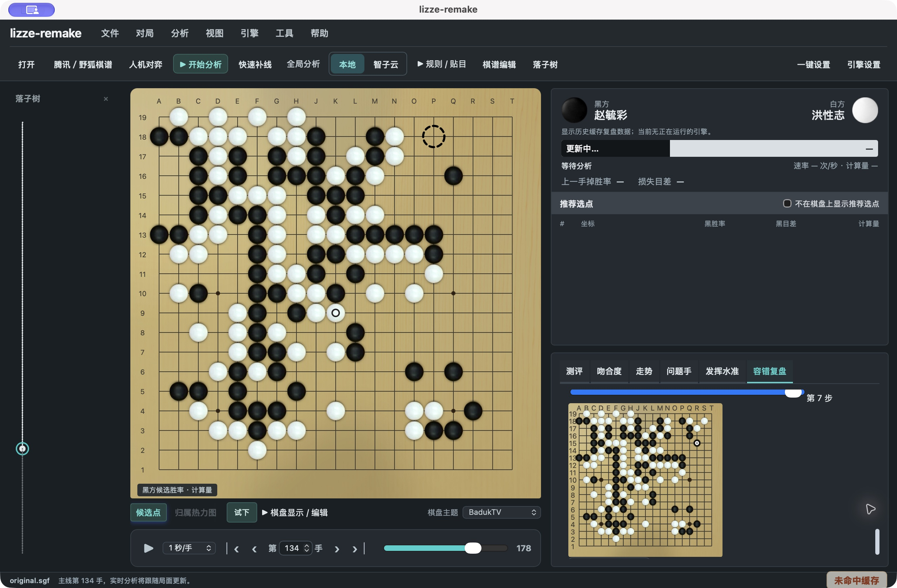

# 容错复盘验证（2026-10-05）

范围为本轮工作区新增容错模块及其 SGF / 引擎生命周期接线。仓库开始时已有大量未提交修改，本轮保留；没有创建发布、提交或替换安装包。

## 已完成检查

| 检查 | 实际结果 |
|---|---|
| 文档工具与 Git hook | `install.py --root . --git-hook` 成功；本地 skill 无需更新，项目 hook 已安装 |
| analysis-core 容错计算 | 4 项通过，含白方视角、对称候选未知、浮点概率与 pass 坐标 |
| 桌面容错单元测试 | 6 项通过；远端专用测试普通运行中忽略。包含三份真实 waffle 响应的逐指标黄金核对、SGF 历史、主线扫描与加深去重、SSH 引号、合法三决策分支、部分保存、缓存，以及本地**模拟进程**关闭 |
| 桌面库整体回归 | 201 项通过、4 个环境测试忽略，含共享 registry、实时本地/SSH 及云协议相关边界；不等于三来源实时云实测 |
| SSH supervisor | 2 项 Python 测试通过，验证关闭控制及 stdin EOF 均回收测试子进程组 |
| SGF 回归 | 75 项通过；另在容错位置测试中覆盖 UTF-8 BOM |
| 前端领域测试 | 90 项通过，0 失败；新增概率阈值、旧任务/旧棋谱隔离、文档 SHA-256 测试 |
| 受管文档 / 脚手架 | 26 篇文档结构检查 0 findings；脚手架 10 项通过 |
| TypeScript + Vite | 构建通过，保留既有大于 500 kB chunk 提示 |
| 浏览器交互 | 容错标签、折叠配置、三种任务入口可见；浏览器启动计算明确要求桌面后端。已查看窄窗口布局；真实数据回放中切换目差/胜率口径，分布及分支数值同步更新 |

## 远端与证据

两次真实验收均通过，使用赵毓彩—洪性志原始棋谱第 135 手前局面，经三跳 SSH 连接 waffle，TF11 + HumanSL 职业档位。资源检查 GPU 0%、显存 2 MiB、可用内存 27 GiB、磁盘可用 1.6 TiB；未启动本地真实引擎。

- 首次较高预算：8192 次加深，62 次查询，4 条分支，每条 3 次己方决策；504.42 秒。该次验证运行的是补搜上限仍为 8192 的早期实现，随后已将补搜上限调整为 2048。
- 最终实现：2048 次加深、每局面最多补搜 1 点，24 次查询，3 条满足条件的分支，每条 3 次己方决策；63.02 秒。不能把较少分支说成所有应手覆盖。
- 最终实现原样重跑 24 个查询全部命中缓存，无新查询；再次独立启动验收进程也全部命中，6.33 秒完成；另发送高预算查询后，在运行中取消并成功取得远端进程退出确认。
- 所有生成分支经过项目 SGF 规则引擎逐手合法性校验。JSON checkpoint、带容错注释的变化 SGF 及原始 query/response 均可追溯。

版本、模型/配置哈希、查询数和源码指纹见 [结构化证据](evidence/tolerance-20261005.json)。完整验收输出保存在用户本地分析目录的「项目容错功能验收」，不把私有 SSH 路线写进仓库。浏览器回放入口为开发服务的 `/tests/tolerance-preview.html`，夹具已移除本机和远端路径，来源为首次已完成的远端报告。

黄金夹具 [waffle-20261005.json](../../apps/desktop/tests/fixtures/tolerance/waffle-20261005.json) 来自此前完成的该盘真实分析，用于确定性数值回归；它不是本轮在线验收的输出。

## 原生窗口验收补充

本次使用当前源码构建的 macOS debug `.app`，实际窗口地址为 `tauri://localhost`。锁屏限制解除后完成以下操作，结果已写入同一结构化证据的 `nativeWindowRuns`：

| 原生操作 | 观察与文件核对 |
|---|---|
| 打开原始 SGF / 恢复结果 | 178 手棋谱通过系统打开对话框载入；重启后重新打开同一棋谱，自动恢复最近报告；示例棋谱不显示这盘棋的报告 |
| 当前局面计算 | UI 发起 waffle 任务，8192 加深预算；完成 1 个局面，1 次新查询、1 次缓存命中 |
| 扫描及取消 | 全盘任务目标 179 个局面，完成 7 个后从 UI 取消；checkpoint 保留 7 个局面，终态 `cancelled`，`cleanupConfirmed=true` |
| 取消后重跑 | 当前局面完成，0 次新查询、2 次缓存命中；按钮恢复可用，独占槽已释放 |
| 分支比较 | UI 发起 2048 加深预算任务，2 次新查询、24 次缓存命中，3 条分支、10/10 完成，远端关闭确认通过 |
| 分支预览隔离 | 切换至 N16 → R17，并将预览推进到第 7 步；主棋盘仍为第 134 手，预览棋盘显示对应变化 |
| 原生导出 | 系统保存对话框导出 JSON 与带容错注释的 SGF；JSON 可解析；SGF 主线 178 手与原谱逐手一致，原文件 SHA-256 未变 |
| 最终构建 | `npm run tauri:build -- --debug --bundles app` 通过；保留既有 chunk 大小及 Rust unused/dead-code 警告 |

窗口验收发现并修正两处 CSS 问题：容错面板高度未限制在分析区内、长表格撑宽内容；变化棋盘继承主棋盘的尺寸变量而被裁切。修正后标签栏固定可见，内容在面板内部滚动，宽表格独立横向滚动，小棋盘完整显示。此次为布局修复，不新增长期决定记录。

完整原生输出位于本地「项目容错功能验收/native-window」。临时降低的容错预算已恢复；为避免启动本地计算而临时禁用的引擎 profile 也已逐字节恢复。原生验收期间未运行本地真实引擎。

## 验收范围

本轮已验证原生 Tauri IPC、SSH 任务、取消后重跑、持久化恢复、变化预览及系统导出对话框。全盘扫描验证到 7/179 后主动取消，未宣称全盘计算完成。前景本地/SSH/智子云三来源的活动会话自动恢复仍未逐一实测；现有 registry 与事件隔离测试不能替代这项实测。智子云完整 HumanSL 能力未验证，入口禁用；本地计算路径只使用模拟进程测试。没有执行签名、安装包或发布验收。
